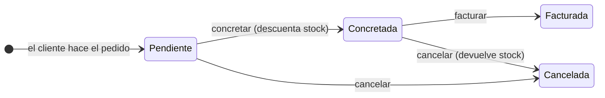

# Documentación

## El negocio

Pauny vende maquinaria agrícola y ofrece servicios técnicos (mantenimiento, reparaciones) que se cobran por hora. El sistema reemplaza el seguimiento a mano de pedidos y ventas.

Hay cuatro tipos de usuario, y cada uno ve solo lo que le corresponde:

| Rol | Qué hace |
|---|---|
| **Cliente** | Mira el catálogo, arma pedidos, pide servicios y consulta sus compras y facturas |
| **Vendedor** | Atiende los pedidos: los concreta, los cancela y los factura |
| **Operario** | Toma los pedidos de servicio y los finaliza con las horas trabajadas |
| **Administrador** | Todo lo anterior, más los ABM (productos, servicios, clientes, vendedores, operarios, localidades) y las cuentas de usuario |

## Casos de uso

**Concretar Venta.** El cliente arma un pedido desde el catálogo y queda *pendiente*. Un vendedor lo revisa y lo concreta: el sistema controla que haya stock, lo descuenta y avisa al cliente por mail. Si no hay stock suficiente, avisa qué producto falta y no cambia nada. Un pedido pendiente o concretado se puede cancelar; si estaba concretado, el stock vuelve.

**Solicitar Servicio.** El cliente pide un servicio, indica cuántas horas estima y una fecha preferida, y ve el importe estimado. El operario del servicio la acepta y, al terminar, carga las horas reales: el importe final se calcula con esas horas.

**Realizar facturación.** Sobre una venta concretada, el vendedor emite la factura: numeración correlativa (`0001-00000001`), IVA del 21 % discriminado y una copia de los datos del cliente. Una venta se factura una sola vez y la factura no se modifica después. El cliente ve sus facturas desde su portal.

**Adicional: avisos por mail.** El cliente recibe un mail cuando se recibe su pedido, cuando se confirma la compra y cuando se cancela.

## API

API REST en JSON. Para entrar: `POST /usuarios/login` con `{ "usuario", "contraseña" }`; devuelve un token que se manda en las demás peticiones como `Authorization: Bearer <token>`. Los errores vuelven como `{ "message": "..." }` con el código correspondiente (400 datos inválidos, 401 sin sesión, 403 sin permiso, 404 no existe, 409 conflicto, por ejemplo falta de stock).

| Recurso | Rutas | Quién |
|---|---|---|
| Usuarios | `POST /usuarios/login` · ABM en `/usuarios` | login: todos · ABM: admin |
| Clientes | `/clientes` | registro público; el cliente ve y edita solo su ficha |
| Productos y servicios | `/productos` · `/servicios` | todos ven; admin (y operario en servicios) edita |
| Vendedores, operarios, localidades | `/vendedores` · `/operarios` · `/localidades` | admin; cada uno edita su propio perfil |
| Ventas | `/ventas` · `POST /ventas/:id/concretar` · `/cancelar` · `/facturar` | vendedor y admin; el cliente ve y cancela sus pedidos |
| Facturas | `/facturas` (solo lectura) | vendedor y admin; el cliente, las suyas |
| Solicitudes de servicio | `/solicitudes-servicio` · `POST .../:id/aceptar` · `/finalizar` · `/cancelar` | el cliente pide; operario y admin atienden |

Detalle de cada ruta y sus reglas: [README del back](https://github.com/miltonsark/Tp-Dsw-BackEnd#endpoints-principales).

## Tests

Última ejecución: 26/11/2026, todos aprobados.

| Dónde | Tipo | Cantidad | Comando |
|---|---|---|---|
| Back | Unitarios (Vitest) | 128 | `npm run test:unit` |
| Back | Integración (API completa con una base de prueba) | 53 | `npm run test:integration` |
| Front | Unitarios de componentes y servicios (Jasmine) | 190 | `npm test` |
| Front | End-to-end (Playwright, en celular y escritorio) | 18 | `npm run test:e2e` |

Los e2e recorren los casos de uso completos: login, compra, solicitud de servicio, facturación y ABM de usuarios. Las capturas de cada paso están en el [repo del front](https://github.com/miltonsark/Tp-Dsw-FrontEnd/tree/main/docs/evidencia-e2e).

## Cómo trabajamos

Usamos **Kanban** sobre GitHub, sin herramienta aparte: cada tarea es una rama (`feat/`, `fix/`, `test/`) y un pull request que se revisa y se mergea a `main`. Cada merge a `main` publica la app en Vercel.

Los PR están en los repos originales del grupo (hasta noviembre de 2026 los repos estuvieron en la cuenta de un ex integrante, Ignacio Ramírez; para el deploy los pasamos a la cuenta de Milton):
[PR del back](https://github.com/Ignacioramirez98/Tp-Dsw-BackEnd/pulls?q=is%3Apr+is%3Amerged) · [PR del front](https://github.com/Ignacioramirez98/Tp-Dsw-FrontEnd/pulls?q=is%3Apr+is%3Amerged)

## Minutas de avance

No llevamos actas; este resumen sale del historial de commits y PR.

| Fecha | Avance |
|---|---|
| Abr – Oct 2024 | Propuesta del TP. Primeros CRUD en el back (producto, vendedor, cliente) y login en el front |
| Nov 2024 | ABM de productos y primer proceso de venta en el front |
| Ago 2026 | Se retoma el TP: ABM de vendedor, localidad y operario en el front |
| 31 Oct – 1 Nov 2026 | Back completo para regularidad (capas, validaciones, permisos, tests) y front rehecho mobile-first con el CUU Concretar Venta |
| 22 – 23 Nov 2026 | Manejo de errores, reactividad, ambientes y primer test e2e |
| 24 Nov 2026 | CUU Solicitar Servicio, ABM de usuarios, CUU Realizar facturación y avisos por mail |
| 25 Nov 2026 | Base nueva en MongoDB Atlas y deploy de front y back en Vercel |
| Pendiente | Video demo |

## Deploy

Front y back en **Vercel**, base en **MongoDB Atlas** e imágenes en **Vercel Blob**. Cada merge a `main` vuelve a publicar la app. Links y usuarios de prueba en el [README](../README.md).
